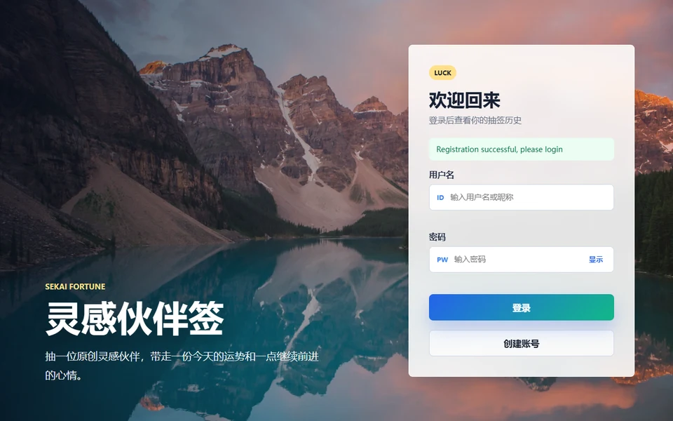

# 馃帎 Sekai Fortune 路 瑙掕壊鎶界涓庝粖鏃ヨ繍鍔?
> **缁熶竴瑙掕壊搴撴娊绛?+ 浼氬憳鏀舵闂幆 MVP**
> Fortune-drawing MVP with unified character pool & membership payment loop

[](https://www.oracle.com/java/)
[](https://spring.io/projects/spring-boot)
[](https://mybatis.org/)
[](https://www.mysql.com/)
[](https://github.com/sekai-lyr/sekai-fortune)
[](LICENSE)

缁熶竴瑙掕壊搴撴娊绛句笌浠婃棩杩愬娍 MVP锛氭櫘閫氱敤鎴蜂粠鍏变韩瑙掕壊搴撻噷鎶界銆佹敹钘忋€佹煡鐪嬪巻鍙诧紱瑙掕壊搴撶敱绉嶅瓙鏁版嵁鍜岀鐞嗗憳缁存姢锛屽唴缃?*瀹屾暣浼氬憳鏀舵闂幆**銆?
Fortune-drawing MVP with a shared character pool, plus a complete membership payment loop.

## 鉁?鏍稿績鍔熻兘 Core Features

- 缁熶竴瑙掕壊绉嶅瓙鏁版嵁锛屾墍鏈夌敤鎴峰叡浜悓涓€濂楄鑹插簱 Shared character pool
- 鏅€氱敤鎴锋棤鏂板/缂栬緫/鍒犻櫎瑙掕壊鍏ュ彛 Role library admin-only
- 瑙掕壊鍥剧墖涓虹┖鎴栨媺鍙栧け璐ユ椂锛屽悗绔嚜鍔ㄧ敓鎴愬厹搴?SVG 澶村儚 Auto SVG fallback avatars
- 鏁版嵁搴撹繛鎺ョ幆澧冨彉閲忓寲 Env-var database config

## 馃挸 鎵嬪姩鏀舵浼氬憳闂幆 Membership Payment Loop

鏃犻渶寰俊鍟嗘埛鍙峰嵆鍙窇閫氭敹娆?MVP锛坢anual WeChat QR flow锛夛細

1. 鐢ㄦ埛杩涘叆 `/membership` 閫夋嫨濂楅骞剁敓鎴愯鍗?2. 椤甸潰灞曠ず寰俊鏀舵鐮佸拰浠樻澶囨敞
3. 鐢ㄦ埛鎵爜浠樻鏃跺～鍐欏娉?4. 纭鍒拌处鍚庯紝鍚庡彴瀹℃壒鎺ュ彛寮€閫氫細鍛?
浼氬憳鏉冪泭锛氫笁杩炵浠紡 路 娣卞害瓒嬪娍鍒嗘瀽 路 楂樺垎绛惧洖鐪?路 鎶界鍒嗕韩鍗?
鏌ョ湅寰呭鐞嗚鍗曪細

```powershell
Invoke-WebRequest "http://localhost:8084/admin/membership/orders?token=$env:ADMIN_TOKEN" -UseBasicParsing
```

鎵瑰噯璁㈠崟锛?
```powershell
Invoke-WebRequest "http://localhost:8084/admin/membership/orders/璁㈠崟ID/approve?token=$env:ADMIN_TOKEN" -Method POST -UseBasicParsing
```

## 馃搻 鍒濆鍖栨暟鎹簱 Database Setup

```sql
CREATE DATABASE IF NOT EXISTS sekai_friend DEFAULT CHARACTER SET utf8mb4 COLLATE utf8mb4_unicode_ci;
```

```powershell
mysql -uroot -p --default-character-set=utf8mb4 -D sekai_friend < build-data/init.sql
```

## 鈻讹笍 杩愯 Run

璁剧疆鐜鍙橀噺锛?
```powershell
$env:DB_URL="jdbc:mysql://127.0.0.1:3306/sekai_friend?serverTimezone=Asia/Shanghai&useUnicode=true&characterEncoding=utf-8&useSSL=false&allowPublicKeyRetrieval=true"
$env:DB_USERNAME="root"
$env:DB_PASSWORD="浣犵殑鏁版嵁搴撳瘑鐮?
$env:SERVER_PORT="8084"
$env:ADMIN_TOKEN="鑷繁璁剧疆涓€涓悗鍙板鎵瑰瘑鐮?
$env:WECHAT_QR_URL="/img/wechat-qr.jpg"

mvn spring-boot:run
```

榛樿绔彛 `8084`銆傝嚜瀹氫箟鏀舵鐮侊細灏嗗浘鐗囨斁鍒?`src/main/resources/static/img/wechat-qr.jpg` 骞惰缃?`WECHAT_QR_URL`銆?
## 馃殌 涓嬩竴姝ュ彉鐜版柟鍚?Monetization Roadmap

1. **鍏嶈垂鐗?*锛氭瘡鏃ュ浐瀹氱銆佸熀纭€鍘嗗彶銆佸皯閲忎紮浼?2. **浼氬憳鐗?*锛氫笁杩炵浠紡銆佹繁搴﹁秼鍔挎姤鍛娿€佹洿澶氫紮浼翠富棰樸€佸垎浜崱鐗?3. **B 绔畾鍒?*锛氫负绀剧兢銆佸垱浣滆€呫€佹椿鍔ㄦ柟瀹氬埗浼欎即搴撳拰鎶界椤甸潰锛屾寜椤圭洰璐规垨鏈堣垂鏀惰垂

## 馃搫 License

[MIT](LICENSE) 漏 2026 [sekai-lyr](https://github.com/sekai-lyr)


<p align="center">
  
</p>
---

**猸?If this project helped you, star it! 濡傛灉杩欎釜椤圭洰瀵逛綘鏈夊府鍔╋紝娆㈣繋 Star锛?*

